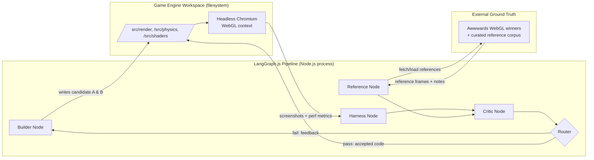
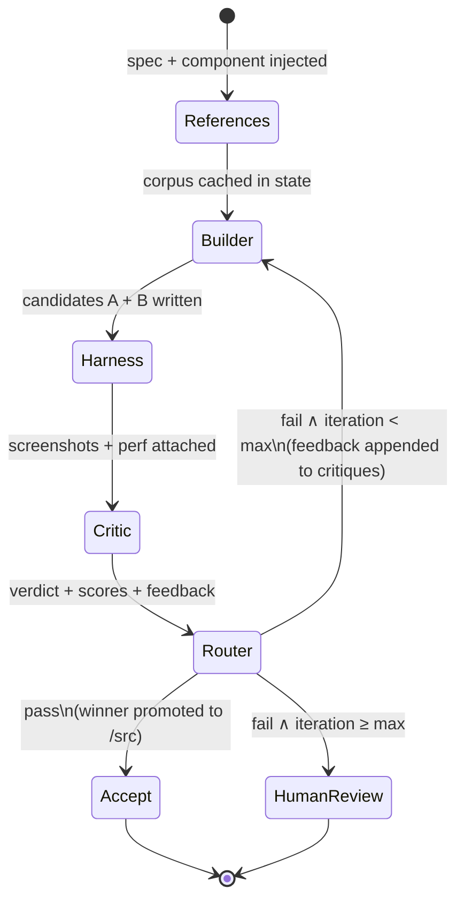
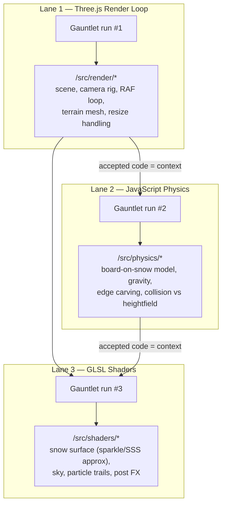

# Architecture — Gauntlet Loop Orchestration for the Snowboarding Game

**Stack under generation:** Three.js (render loop) · native JavaScript physics · raw GLSL shaders
**Orchestrator:** LangGraph.js (`@langchain/langgraph`) with Zod-validated state
**Methodology:** Gauntlet Loop — blind A/B builder/critic cycles, externally grounded against award-winning WebGL references

---

## 0. System at a Glance



One important structural decision up front: **the Critic never talks to the Builder directly, and never sees builder provenance.** Everything flows through the typed state channel. That is what makes the A/B evaluation *blind* — the Critic receives two anonymized candidates plus reference material, nothing else.

A second decision: a **Harness node** sits between Builder and Critic. An LLM critic cannot perceive pixels or frame rates from source code alone. The Harness runs each candidate in headless Chromium, captures screenshots and performance metrics, and attaches them to the state. Without this node the "evaluation against Awwwards references" would be the Critic imagining what the code looks like — which defeats the entire methodology.

---

## 1. State Machine Design

### 1.1 Nodes

| Node | Role | Reads from state | Writes to state |
|---|---|---|---|
| `builder` | Generates **two independent candidate implementations** (A/B) of the current component. On re-entry, incorporates accumulated critique feedback. | `component`, `spec`, `feedback`, `critiques`, `acceptedComponents` | `candidates`, `iteration` |
| `harness` | Deterministic (non-LLM) node. Writes each candidate to an isolated sandbox dir, boots it in headless Chromium, captures N screenshots across a scripted camera path, records FPS / frame time / draw calls / console errors. | `candidates` | `candidates` (enriched with `screenshots`, `perf`, `runtimeErrors`) |
| `references` | Tool node. Loads the reference corpus for the current component (see §3.3) — reference frames, technique notes, perf baselines from Awwwards-winning WebGL work. Cached after first fetch. | `component` | `references` |
| `critic` | Evaluates anonymized candidates against the spec and the reference corpus. Scores per axis, picks a winner, issues a verdict and actionable feedback. Runs with a **separate model context** — it never sees the Builder's reasoning or which candidate came first. | `spec`, `candidates` (anonymized view), `references`, `critiques` | `critiques`, `verdict`, `winner`, `feedback` |
| `accept` | Deterministic node. Promotes the winning candidate's files into the real `/src` tree, records it in `acceptedComponents`. | `candidates`, `winner` | `acceptedComponents` |
| **State management** | Not a node — the graph's **channels + reducers + checkpointer** (§1.3, §1.4). Every hop is Zod-validated; every superstep is checkpointed so a crashed cycle resumes instead of restarting. | — | — |

### 1.2 State schema (Zod)

LangGraph.js accepts a Zod object as the graph state schema via the `@langchain/langgraph/zod` registry extension, which adds `.langgraph.reducer()` for append-style channels.

```ts
import { z } from "zod";
import "@langchain/langgraph/zod"; // enables .langgraph.reducer()

// ---------- sub-schemas ----------

const CandidateSchema = z.object({
  id: z.string(),                                // opaque label ("cand-x7f2"), no provenance
  files: z.record(z.string(), z.string()),       // relative path -> source
  runtimeErrors: z.array(z.string()).default([]),
  screenshots: z.array(z.string()).default([]),  // paths to captured PNG frames
  perf: z
    .object({
      avgFps: z.number(),
      p95FrameTimeMs: z.number(),
      drawCalls: z.number(),
      gpuMemMb: z.number().nullable(),
    })
    .nullable()
    .default(null),
});

const ReferenceSchema = z.object({
  title: z.string(),                 // e.g. "Igloo Inc — Awwwards SOTY 2024"
  url: z.string().url(),
  frames: z.array(z.string()),       // local paths to reference screenshots
  techniqueNotes: z.string(),        // what to learn from it (fog, PBR snow, motion feel)
  perfBaseline: z.object({ targetFps: z.number() }).nullable(),
});

const CritiqueSchema = z.object({
  iteration: z.number(),
  winner: z.enum(["A", "B"]).nullable(),   // null = both rejected
  scores: z.record(
    z.enum(["A", "B"]),
    z.object({
      visualFidelity: z.number().min(0).max(10),
      referenceProximity: z.number().min(0).max(10), // vs. Awwwards corpus
      codeQuality: z.number().min(0).max(10),
      performance: z.number().min(0).max(10),
      specCompliance: z.number().min(0).max(10),
    })
  ),
  actionableFeedback: z.array(z.string()), // concrete, imperative fixes
  verdictRationale: z.string(),
});

// ---------- graph state ----------

export const GauntletState = z.object({
  // which lane of the game we are generating
  component: z.enum(["render-loop", "physics", "shaders"]),
  spec: z.string(),                          // component requirements (input)

  // loop control
  iteration: z.number().default(0),
  maxIterations: z.number().default(5),
  passThreshold: z.number().default(7.5),    // min avg score to accept

  // per-cycle payload (overwritten each iteration)
  candidates: z
    .object({ A: CandidateSchema, B: CandidateSchema })
    .nullable()
    .default(null),

  // append-only channels (reducers concat instead of overwrite)
  references: z
    .array(ReferenceSchema)
    .default([])
    .langgraph.reducer((cur, next: ReferenceSchema[]) => cur.concat(next)),
  critiques: z
    .array(CritiqueSchema)
    .default([])
    .langgraph.reducer((cur, next: CritiqueSchema[]) => cur.concat(next)),

  // critic output for routing
  verdict: z.enum(["pending", "pass", "fail"]).default("pending"),
  winner: z.enum(["A", "B"]).nullable().default(null),
  feedback: z.string().nullable().default(null),

  // cross-component memory: accepted code becomes context for the next lane
  acceptedComponents: z
    .record(z.string(), z.record(z.string(), z.string())) // component -> {path -> source}
    .default({}),
});

export type GauntletStateT = z.infer<typeof GauntletState>;
```

Why these choices:

- **`candidates` is overwrite, `critiques`/`references` are append.** Each iteration produces fresh candidates, but critique history must accumulate — that history is what stops the Builder from oscillating between the same two mistakes.
- **`acceptedComponents` is the only cross-lane channel.** When the shader lane runs, the Builder sees the *accepted* render loop and physics code — never rejected drafts.
- **Zod validates at every node boundary.** A Builder that returns malformed candidates fails loudly at the graph edge, not silently at the Critic.

### 1.3 Graph wiring

```ts
import { StateGraph, START, END, MemorySaver } from "@langchain/langgraph";

const checkpointer = new MemorySaver(); // swap for SqliteSaver for durable runs

const graph = new StateGraph(GauntletState)
  .addNode("builder", builderNode)
  .addNode("harness", harnessNode)
  .addNode("references", referenceNode)
  .addNode("critic", criticNode)
  .addNode("accept", acceptNode)
  .addEdge(START, "references")
  .addEdge("references", "builder")
  .addEdge("builder", "harness")
  .addEdge("harness", "critic")
  .addConditionalEdges("critic", route, {
    retry: "builder",
    accept: "accept",
    escalate: END,          // maxIterations exhausted -> human review
  })
  .addEdge("accept", END)
  .compile({ checkpointer });

function route(state: GauntletStateT): "retry" | "accept" | "escalate" {
  if (state.verdict === "pass") return "accept";
  if (state.iteration >= state.maxIterations) return "escalate";
  return "retry";
}
```

### 1.4 State machine diagram



**Checkpointing:** the graph compiles with a checkpointer (`MemorySaver` in dev, SQLite for real runs) keyed by `thread_id = component name`. A crash mid-cycle resumes from the last completed node. Iteration 4 of the shader gauntlet never has to re-run iterations 1–3.

---

## 2. Component Architecture

The three game components run through the **same compiled gauntlet graph**, invoked sequentially in dependency order. Each invocation is a separate thread with its own checkpoint history; accepted output feeds forward via `acceptedComponents`.

### 2.1 Lane order and rationale



| Lane | Component | Why this order | What the Harness measures | What the Critic weights hardest |
|---|---|---|---|---|
| 1 | **Three.js render loop** | Everything else hangs off it. Physics needs a heightfield to collide with; shaders need materials/meshes to attach to. | Boots without errors, stable RAF cadence, resize correctness, draw calls, 60fps on a scripted camera flythrough | Spec compliance, code quality, performance |
| 2 | **JS physics math** | Depends on Lane 1's terrain representation. Pure native JS (no cannon/rapier per project constraint). | Deterministic replay of a scripted run: board position/velocity traces, penetration depth vs heightfield, energy drift over 30s | Physical plausibility (trace analysis), spec compliance |
| 3 | **GLSL shaders** | Last because it is the most reference-driven lane and needs real geometry + motion to be judged on. | Compile status per shader, screenshot set under 3 lighting conditions, frame time delta vs Lane 1 baseline | **Reference proximity** (Awwwards corpus), visual fidelity |

### 2.2 Data flow between the pipeline and the engine

The LangGraph process never imports Three.js. The boundary is the filesystem plus a headless browser:

```
LangGraph process                    │  Engine workspace
                                     │
builder ──writes──────────────────►  │  /sandbox/<candidate-id>/src/...
                                     │  (Vite dev build, isolated per candidate)
harness ──launches────────────────►  │  headless Chromium + WebGL
        ◄──screenshots, perf JSON──  │  (scripted camera path, perf hooks)
                                     │
accept ──promotes winner──────────►  │  /src/render | /src/physics | /src/shaders
                                     │  (the real game tree; git-committed per lane)
```

Rejected candidates never touch `/src`. The game tree only ever contains gauntlet winners, one commit per accepted lane, so `git log` is a clean record of what survived.

---

## 3. Gauntlet Loop Rationale — Why LangGraph, Not a Single Prompt

### 3.1 The failure mode of the single prompt

A single "build me a beautiful snowboarding game" prompt fails in four specific, structural ways:

1. **Self-grading bias.** A model asked to generate and evaluate in one context grades its own work with the same blind spots that produced it. The Critic here runs in a *separate context* with a different system prompt, no access to the Builder's reasoning, and anonymized candidate labels. It cannot be anchored by the Builder's stated intent — it only sees what the code actually renders.
2. **No external ground truth.** "High-fidelity" is meaningless without a yardstick. A single prompt's notion of quality is its training-data average — which is exactly the generic-WebGL-demo look we are trying to avoid. The Gauntlet grounds every evaluation in a concrete corpus of award-winning work (§3.3).
3. **No memory across attempts.** Re-prompting manually loses the critique history; the model happily reintroduces a mistake fixed two rounds ago. The `critiques` channel is append-only and re-injected into every Builder call: *"you have already been told the fog washes out at distance > 400 — do not regress."*
4. **No deterministic control flow.** "Try again until it's good" done by hand is vibes. The graph makes it mechanical: typed verdict, score threshold, bounded iterations, checkpointed resume, and a hard escalation path to human review when the loop stalls.

### 3.2 Why blind A/B specifically

Generating **two** candidates per cycle and forcing the Critic to rank them does two things a pass/fail check cannot:

- It converts evaluation from an absolute judgment ("is this good?" — where LLM critics are lenient) into a **relative** one ("which is better, and why?" — where they are far more discriminating).
- The loser's failure modes become free training signal: the winner's next iteration inherits "what beat you and why" via `actionableFeedback`.

Blindness matters: candidate labels are opaque IDs, order is shuffled by the Harness, and the Critic's context contains no builder chain-of-thought. The Critic judges rendered frames, perf numbers, traces, and source — not narrative.

### 3.3 How the Critic evaluates against Awwwards-winning WebGL references

The `references` node grounds the Critic. Honest constraint stated plainly: **a critic cannot browse a live WebGL site**, and scraping Awwwards at runtime is brittle and ToS-hostile. So the corpus is built once, ahead of the run, as a **curated local reference set**:

1. **Curation (one-time, human + agent):** pick 4–6 Awwwards winners relevant per lane — e.g. snow/terrain-heavy SOTD/SOTY winners for the shader lane, buttery camera/motion work for the render lane. For each: capture 3–5 representative frames, write `techniqueNotes` (what specifically is excellent — snow sparkle via noise-jittered specular, aerial-perspective fog, camera lag on carve), record a `perfBaseline`.
2. **Fetch at graph time:** the `references` node loads this corpus into state (fetching live pages only to verify URLs still resolve). Cached via the append-only reducer, so it is fetched once per thread.
3. **Evaluation:** the Critic receives candidate screenshots *side-by-side with reference frames* and scores `referenceProximity` per candidate — not "does this look nice" but "how far is this from the standard the corpus sets, and what technique visible in the reference is missing here." Those gaps land in `actionableFeedback` as imperative instructions for the next Builder pass.

This is the core of the Gauntlet: the quality bar lives **outside** the model, in artifacts the model didn't produce, so the loop converges toward an external standard instead of the model's own mean.

### 3.4 What LangGraph specifically buys us

| Need | LangGraph mechanism |
|---|---|
| Typed contract between agents | Zod state schema, validated per superstep |
| Blind separation of Builder/Critic | Separate nodes, separate model contexts, state-only communication |
| Accumulating critique memory | Append-only reducer channels |
| Bounded, resumable loops | Conditional edges + checkpointer (`thread_id` per lane) |
| Tool use for grounding | `references` node as a tool-calling step |
| Human escape hatch | `escalate` edge to END → human review of best-so-far |
| Observability | Every superstep inspectable in LangSmith / checkpoint history |

---

## 4. Next Steps — First Gauntlet Cycle (Lane 1: Three.js Render Loop)

Prerequisites, in order:

1. Scaffold the repo: `npm create vite@latest` (vanilla), `npm i three zod @langchain/langgraph @langchain/anthropic playwright`.
2. Build the Lane-1 reference corpus (§3.3, step 1) into `/references/render-loop/`.
3. Implement `harness.ts` (Playwright headless Chromium, scripted camera path, perf capture). This is the one piece of hand-written infrastructure the loop cannot bootstrap for itself.
4. Wire the graph exactly as §1.3 and run it with the prompt below as `spec`.

**The exact Gauntlet Loop prompt to trigger the first Builder/Critic cycle:**

```text
GAUNTLET LANE 1 — THREE.JS RENDER LOOP

Component: render-loop
Max iterations: 5, pass threshold: 7.5

SPEC:
Build the core Three.js render loop for a high-fidelity 3D snowboarding game.
Produce TWO independent candidate implementations (A and B) that each deliver:

1. Scene bootstrap: WebGLRenderer (antialias, correct color space, tone mapping
   exposed as a config), PerspectiveCamera on a rig object, resize handling
   with devicePixelRatio clamp.
2. A mountain terrain mesh generated from a seeded heightfield function
   (export the heightfield sampler — the physics lane will consume it).
3. A fixed-timestep update loop (accumulator pattern) decoupled from the
   requestAnimationFrame render call; expose update(dt) and render(alpha)
   hooks the physics and shader lanes can attach to.
4. A scripted debug camera flythrough (used by the evaluation harness).
5. Placeholder materials only — no custom shaders yet (Lane 3's job).
6. Budget: 60fps at 1080p on integrated graphics; < 150 draw calls.

The two candidates must differ meaningfully in approach (e.g. terrain
chunking strategy, camera rig design) — not be cosmetic variants.

Deliver each candidate as a complete file map under src/render/.
You will be evaluated blind against the Lane-1 reference corpus on:
visual fidelity, reference proximity, code quality, performance,
and spec compliance. Prior critique history (if any) is attached; every
item of actionable feedback must be either addressed or explicitly rebutted.
```

Run it:

```ts
const result = await graph.invoke(
  { component: "render-loop", spec: LANE_1_SPEC },
  { configurable: { thread_id: "render-loop" } }
);
```

When Lane 1 passes, the accepted files land in `/src/render`, get committed, and Lane 2 (physics) launches with them in `acceptedComponents`.
